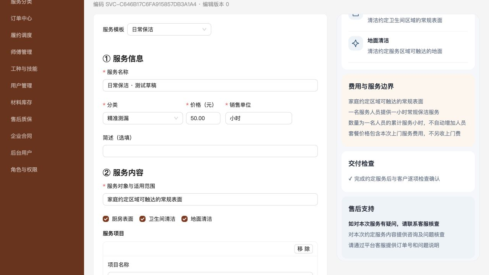

# PLAN-013｜通用服务 SKU 执行与验收记录

日期：2026-10-29（Asia/Shanghai）

依据：[SPEC-013 V2.2](../specs/SPEC-013-通用服务SKU管理与结构化图文详情.md)、[PLAN-013 V1.2](../plans/PLAN-013-通用服务SKU管理与结构化图文详情.md)。

结论：核心代码、本地数据库清理重建、后台四类配置发布及相关自动化检查完成。微信模拟器及真机验收尚未完成，不据此声明所有验收项通过，也没有线上发布。

## 1. 环境与范围

- 本地业务库：`fix_pro`；隔离测试库：`fix_pro_sku_test`，PostgreSQL。未在报告保存连接密码、会话Token或客户原始资料。
- 后台UI测试使用127.0.0.1:5174及8081，均连接隔离测试库；本地业务服务仍使用8080及原有环境密钥。
- 后台测试账号仅在测试库创建，未重置实际业务库账号或密码。
- 微信界面工具返回macOS锁屏，无法继续原生开发者工具操作。已使用其官方wcc/wcsc编译器检查源文件，但编译不能代替真实运行及真机验收。
- 未覆盖同时发生的客户小程序首页样式改动；相关回归仍通过。

## 2. 实际 SKU 删除与重建

先停止旧服务写入，再执行一次性迁移000020；此前17～19为仓库已有待执行迁移，随正常迁移链应用。清理和结构变更在事务中执行，拒绝有订单或明细的环境。

| 数据 | 删除前 | 删除后、新草稿创建前 |
| --- | ---: | ---: |
| service_sku | 2 | 0 |
| service_sku_version | 3 | 0 |
| shopping_cart_item | 1 | 0 |
| customer_order | 0 | 0 |
| order_item | 0 | 0 |
| service_category | 6 | 6 |
| worker_skill | 0 | 0 |
| media_asset | 7 | 7 |

没有导出并保留旧SKU内容作为兼容数据；在创建新样板前，主表/版本/关联购物车清空为0，证明旧数据已实际移除。账号、权限、地址等不在删除语句范围内，媒体实体与存储文件保留。

随后显式执行 `seed-service-skus`：首次创建4个DRAFT，再次执行每项新增0，未覆盖草稿。新草稿价格为0、无主图、未完成业务参数，不可发布；当前业务库无订单、无发布版本，公开目录为空，等待运营填写后核对上架。

新建草稿：墙面局部补漆、日常保洁、开荒保洁、设备检测。它们不是恢复旧SKU，也不是带测试承诺的正式服务。

## 3. 已实现

- detailProfile为服务内容、数量/费用、交付售后和需求采集的唯一来源；旧三个文本字段、对应快照及fault请求命名已移除。
- 服务端自动生成SKU编码；模板建议值物化保存，草稿与公开发布版本隔离，空增强字段规范化不制造新版本。
- 五组主表单、更多设置、固定增强栏目及手机预览；无页面装修、任意模块或排序配置。
- 一主图基础展示使用图标项目卡、费用边界、交付清单、售后卡；项目图/案例/对照为选填，图片失败有降级。
- 数量规则覆盖加购合并、更新、两条下单及恢复购物车；确认服务版本时绑定用户确认的skuVersion。
- 文字/媒体按SKU条件采集；客户订单及后台读取成交快照，客户资料归属权限保持原边界。
- 草稿素材及不可变发布版本通过业务绑定/sku_snapshot_media保护，修改草稿后不能删除已发布素材。
- 师傅端读取成交承诺；累计额度按本次服务留证，独立对象逐对象留证，购买数量及金额不改变。

## 4. 自动化验证

| 检查 | 结果与覆盖 |
| --- | --- |
| `npm run check` | 通过：后台lint/build、客户及师傅小程序TypeScript |
| `npm run mini:test:home` | 6项通过：公开目录、空态、身份、旧响应及跳转等回归 |
| `npm run mini:test:shopping` | 通过：加购、角标、独立直接下单、滑动/选择/删除；增加变步长和资料条件必填 |
| `go test -count=1 -p 1 ./...` | 通过；设置DB_DSN、CATALOG_TEST_DSN、ORDER_TEST_DSN到专用测试库，FIXPRO_INTEGRATION=1 |
| `go test -race -p 1 ./internal/catalog ./internal/order` | 通过；在专用测试库验证profile、快照、数量和版本路径 |
| 官方wcc | 新组件、详情、购物车、结算、订单及师傅详情WXML编译通过 |
| 官方wcsc | 新组件及客户详情/购物车/结算/订单样式编译通过 |
| OpenAPI | YAML解析、内部schema引用和新接口结构检查；未声明已运行完整外部OpenAPI lint套件 |

Go数据库集成实际覆盖：

- 四类服务通过同一catalog及order链路创建、发布、直接下单与购物车下单；相同内容重复发布去重。
- 保洁不强制照片、补漆缺资料拒绝；管理员素材不能作为客户需求媒体，拒绝后不留下半个订单。
- 价格不变但内容改变时，旧直接下单失败；购物车标记更新，错误确认版本被拒绝，正确确认后方可继续。
- 成交后修改服务，客户与后台仍读取原承诺；数量步长、合并超限及并发加购受约束。
- 独立schema重放完整迁移：存在订单拒绝；中途注入异常回滚DDL及数据；成功后SKU/关联清空、媒体和分类保留。
- 草稿不再引用素材后，不可变发布版本仍阻止删除该素材。
- 80㎡保洁只生成本次服务一组凭证，绑定第2组被拒；一组完整前后证据即可提交完工，独立对象仍要求逐对象证据。

其他需专用外部环境的既有测试（如客户清库专用DSN）未在本次启用；不把它们的skip写成实际通过。

原始结果：[Go测试](assets/plan-013/go-tests.txt)、[竞态检查](assets/plan-013/race-tests.txt)、[前端检查](assets/plan-013/frontend-checks.txt)、[首页回归](assets/plan-013/home-tests.txt)、[购物回归](assets/plan-013/shopping-tests.txt)。

## 5. 后台实际 UI 验证

在隔离测试库通过实际表单和上传流程完成：

| 服务 | 模板 | 结果 |
| --- | --- | --- |
| 日常保洁 | HOME_CLEANING | 勾选3项服务、填写范围和价格、一张主图，无增强内容，发布成功；重新打开读取一致 |
| 开荒保洁 | GENERAL_SERVICE | 自定义服务项目、单位㎡、min50/max300/累计额度；一张主图，发布成功，无专属保洁代码分支 |
| 墙面补漆 | WALL_PAINT_PATCH | 勾选项目、明确材料责任及局部范围；需求文字/照片必填建议可见，发布成功 |
| 设备检测 | DEVICE_INSPECTION | 检测及结果说明，售后支持，无质保天数和前后对照图要求，发布成功 |

这些测试商品仅在隔离测试库发布，未向本地业务库导入测试价格。图像使用仓库合法测试素材，仅验证上传/预览能力，不代表真实保洁或维修案例。UI测试选用现有测试分类验证分类与模板独立，不把分类当成业务条件。

800px宽度下已验证表单/手机预览切换，恢复原浏览器尺寸。未将这一验证当作微信320/375/430px运行验收。

[主图预览截图](assets/plan-013/admin-editor.png)、[窄屏预览截图](assets/plan-013/admin-narrow-preview.png)。

## 6. SPEC验收映射与待完成项

| 验收 | 本次结果 |
| --- | --- |
| A1/A2 | 四类后台UI配置发布验证，含通用模板；一张主图、不填增强内容可发布 |
| A3 | 条件校验单元测试、后台通用售后政策验证；期限质保缺period被拒 |
| A4 | 后台与API无modules/自由布局；固定增强栏目已实现，组合内容人工回归待补 |
| A5 | 模板替换范围确认及草稿隔离已实现、应用过程验证；取消更换的专项回归待补 |
| A6/A7 | 发布摘要、严格请求校验、草稿/发布差异和编辑版本控制已实现，相关代码/自动化覆盖 |
| B1/B2/B3/B4/B5 | 数量、需求、版本确认及两端成交快照的数据库集成通过；混合购物车真实微信交互待补 |
| B6 | 面积/小时额度与留证对象分离，数据库集成通过；师傅端真机展示待补 |
| C1/C2 | 固定页面、通用标题及断点适配已实现；微信模拟器与真机未完成 |
| C3/C4 | DTO/媒体校验、图片降级、发布引用保护及纯文本渲染已实现，相关自动化覆盖；真实图片失败交互待补 |
| C5/C6 | 一主图基础方案、自动图文增强已实现，后台基础预览验证；微信四类页面及加图/移除图状态转换截图待补 |
| D1/D2/D3/D4/D5 | 实际清理及零残留、迁移/订单事务、无兼容字段、seed幂等及旧目录失效已验证 |

后续需补：解锁电脑后进行微信开发者工具实际运行；至少一台真机的型号/系统/基础库及截图；增强内容增删、模板取消更换、混合购物车、图片失败的真实交互；正式上架前的业务参数与素材核实。

当前不将P6完整验收标记为结束，也不以代码构建通过代替实际发布。无需为继续开发恢复旧SKU或旧兼容模型。
