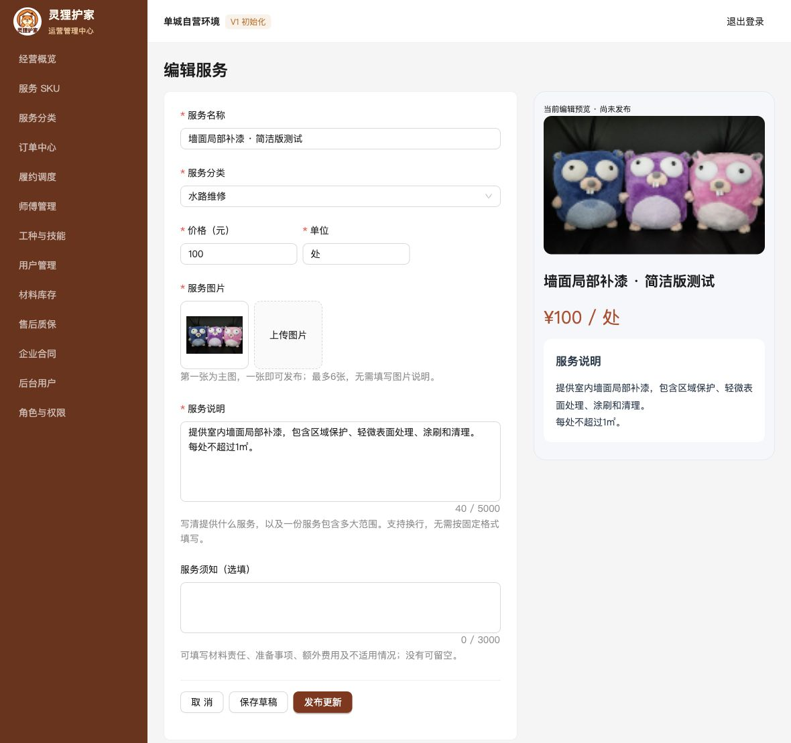

# PLAN-013｜SPEC V3.0 简洁服务 SKU 执行记录

日期：2026-11-05（Asia/Shanghai）；工作于 11 月 4 日开始。

依据：[SPEC-013 V3.0](../specs/SPEC-013-通用服务SKU管理与结构化图文详情.md)、[PLAN-013](../plans/PLAN-013-通用服务SKU管理与结构化图文详情.md)。

结论：核心实现、本地数据重建、后台四类商品配置发布和相关自动化已完成。真实微信模拟器已验证保洁详情及数量小计，430px 截图已保存。320/375px 详情、真机和部分异常场景的完整交互验收未完成；不能据此关闭全部验收，也没有线上部署或上架实际经营商品。

## 1. 实现结果

- 后台仅保留名称、分类、价格、单位、图片、说明、选填须知。单位可选择或直接输入；单张主图即可发布，单图不显示多余排序按钮，多图支持调整主图及顺序。
- 空草稿可保存；占位名称只用于列表显示。发布一次列出全部缺项，支持点击定位及字段中文错误；去掉文案最少字数限制，保留上限及数据安全校验。
- 首次发布没有承诺确认弹窗；更新价格、单位、说明或须知时一次确认。保存与发布失败保留输入及已保存 ID/版本，并区分部分成功状态；发布请求携带预期编辑版本，拒绝并发覆盖。
- 预览及小程序采用两个纯文本区块，须知为空隐藏；保留换行、空行，HTML/Markdown 按原文显示。没有模板、项目列表、质保期限、FAQ、增强内容或逐 SKU 数量/资料规则入口。
- 全链路数量统一为 1～9999、步长1；现场资料和补充需求均选填，媒体权限及上传限制保留。
- 成交说明、须知、价格、单位、数量、图片引用及发布版本冻结；三端读取快照，内容变化也触发购物车版本确认。
- 每订单项必需一组前后凭证，与计价数量分离；允许最多32组凭证作为有界补充，补充组缺少配对不阻止提交。80㎡的工作量仍是80㎡，不会变成1㎡收费，也不要求80个必拍位置。
- 清除运行时的旧 Profile、模板路由、三端旧类型、旧详情组件及仅供旧组件使用的图标；更新 OpenAPI、seed、测试夹具和本地 runbook。历史迁移及历史验收文档保留，不作为兼容运行时使用。
- 当前分类模型没有可复用的审核封面字段，因此本版展示上传入口，没有建设新素材库或自动补图。未添加虚构的客服/政策入口。

## 2. 实际本地切换

实际业务库 `fix_pro`；当前实现的独立测试库 `fix_pro_simple_test`。所有测试商品只在测试库发布，未导入业务库。

停止旧服务写入后重新核对无订单，并保存本地私有备份 `.tmp/simple-sku-before.dump`；已验证备份目录可读取，未宣称已做完整备份恢复演练。随后应用迁移000021，在同一事务中清理旧 SKU 及引用、替换内容列和草稿约束；不修改已执行的000020。

| 数据 | 切换前 | 切换后 |
| --- | ---: | ---: |
| SKU（含全部状态） | 4 | 0 |
| 发布版本 | 0 | 0 |
| 购物车项 | 0 | 0 |
| 订单／订单项 | 0／0 | 0／0 |
| 分类 | 6 | 6 |
| 媒体资产 | 8 | 8 |

切换后 SKU 图片/技能关联、发布版本媒体引用及购物车媒体关联均为0；迁移版本21、dirty=false。账号、分类、技能、地址、权限和媒体文件不在删除范围，实际后台密码未重置。

已启动新本地业务服务，`/actuator/health` 为 UP，公开目录返回空数组。业务库未自动创建草稿或发布测试价格；运营可直接新建服务。

隔离库显式执行新版 seed 两次：首次创建4个待定价、无主图、无说明草稿，第二次均创建0个；不覆盖人工配置，不自动发布。

本次执行顺序有一处记录：关键自动化和隔离后台通过后进行了本地开发切换，未等待真机及所有人工项完成，以保持本地页面和接口契约一致。它不代表 P6 完整通过，也不作为线上发布放行。历史测试库曾因存在订单触发清理保护，没有删除其订单，迁移标记恢复到未执行前状态；完整验证使用了新建的独立测试库。

## 3. 自动化结果

| 检查 | 实际结果 |
| --- | --- |
| `npm run check` | 后台 lint/build、客户及师傅小程序类型检查通过 |
| `npm run mini:test:home` | 6项通过 |
| `npm run mini:test:shopping` | 加购、角标、独立直接下单、滑动/选择/删除等通过；新增统一数量边界与无资料下单断言 |
| Go全量 `go test -count=1 -p 1 ./...` | 通过；DB_DSN、CATALOG_TEST_DSN、ORDER_TEST_DSN 指向独立测试库，FIXPRO_INTEGRATION=1 |
| catalog追加迁移回归 | 加入旧发布图片引用夹具后，清理、拒绝和回滚检查通过 |
| catalog/order `go test -race -p 1` | 通过；并发加购与版本路径实际运行 |
| 官方 wcc/wcsc | 新内容组件及修改的客户/师傅模板、客户相关样式编译通过 |
| OpenAPI | YAML解析及内部引用解析通过；没有宣称通过完整外部 lint 套件 |
| 旧运行时引用与 diff | 未发现 Profile/模板/aggregation 运行时依赖，`git diff --check` 通过 |

数据库集成包括：

- 空草稿、未分类草稿列表、一次返回6个发布缺项、单字名称及说明、单主图无须知发布、长度上限、草稿隔离和错误编辑版本拒绝。
- 四类服务创建、发布、重复发布去重、无资料直接下单及购物车下单；直接下单不改变购物车。
- 非法管理员素材作为客户资料被拒，订单事务不留下半单；合法可选现场资料能够保存。
- 只修改须知、价格不变仍产生版本确认；错误确认版本被拒，成交内容不随商品变化。
- 数量超限、合并超限、并发加购不突破9999；保留拒绝后的数据一致性。
- 新库完整迁移链、已有结构升级、有订单拒绝、事务中途失败回滚、快照媒体引用清除、媒体及分类保留。
- 一次服务至少一组完整前后凭证；额外补充凭证可见且未配对时不阻止完工，购买数量不被修改。

其他要求额外专用环境变量的既有用例可能保持 skip；不将这些 skip 计为实际集成通过。

原始结果：[前端检查](assets/plan-013-v3/frontend-checks.txt)、[Go测试](assets/plan-013-v3/go-tests.txt)、[追加迁移回归](assets/plan-013-v3/catalog-migration-tests.txt)、[竞态检查](assets/plan-013-v3/race-tests.txt)、[首页](assets/plan-013-v3/home-tests.txt)、[购物](assets/plan-013-v3/shopping-tests.txt)。

## 4. 后台真实操作

隔离后台通过真实表单及上传入口完成墙面补漆、日常保洁套餐、开荒保洁套餐、设备检测四类创建及发布。均无模板或专属字段；补漆和检测只上传一张主图、不填须知即可一次发布。测试分类用于验证模板与类目无关，不代表正式经营分类。

另行实测：

- 空表单发布一次列出6项问题，随后仍可直接保存空草稿。
- 修改保洁须知，发布更新只出现一次摘要确认；同价内容变化进入新版本。
- 追加附图、前移为主图、移除附图及图片更新发布。
- 离开有修改的页面出现提醒，取消离开后文字保留。
- 保存草稿后，公开接口仍返回原发布须知。
- 暂停测试后端后保存失败，名称、图片和文字均保留；恢复服务后直接重试成功，无需重新填写。该故障注入没有停止实际业务服务。
- 预览切换及宽屏表单/预览并排显示。截图复核修正了字数提示与帮助文案重叠。

截图仅使用仓库 Go 图片解码测试素材，验证上传和展示能力，不代表真实维修案例或运营素材。

[全部缺项提示](assets/plan-013-v3/all-errors.png)、[手机预览](assets/plan-013-v3/simple-preview.png)。

## 5. 微信模拟器与未完成项

微信开发者工具版本 2.02.2609232 Nightly，实际加载仓库客户小程序。测试期间开发 API 临时指向隔离服务8081，结束后已恢复源文件为原开发地址8080，没有把测试地址提交进项目。

已通过原生界面进入分类与保洁详情，确认名称、单价、说明换行、浅色须知卡及购买底栏；数量1增加到2时，小计从100变成200。已保留390px初始记录与430px实际详情截图。

[430px实际详情](assets/plan-013-v3/wechat-430.png)、[初始模拟器记录](assets/plan-013-v3/wechat-cleaning.png)。

切换屏幕尺寸会使工具重新加载首页。375px仅确认设备切换，未完成详情验收；320px自定义尺寸已配置，继续操作时 macOS 锁屏，工具明确要求手工解锁。不能把设备选择当成详情通过。模拟器当前尺寸可能仍是320px，解锁后可切回原390px设备。

仍待完成：

- 320/375px完整详情及长须知滚动、底栏触达；真机型号/系统/基础库记录及截图。最后统一主图16:10比例和圆角、窄屏标题最小字号，已通过样式编译，需在解锁后复核原生效果，430px截图不作为这两处最终样式的验证。
- 四类服务各自的完整微信界面下单、混合购物车及成交后三端界面回看；相关API链路已有集成覆盖，不能代替界面验收。
- “草稿保存成功、随后发布失败”的专项UI故障注入、并发编辑冲突及图片失效在微信界面的专项交互；实现和服务端测试不能替代这些人工项。

## 6. SPEC验收映射

| 编号 | 结果 |
| --- | --- |
| A1～A3 | 简洁字段、空草稿、单图无须知及短文本通过；上限/非法输入自动化通过 |
| A4 | 后台一次完整缺项提示及字段定位已实现，完整缺项实际截图已记录 |
| A5、A6 | 首次发布、更新一次确认、保存失败重试、离开提醒、草稿隔离实测通过；部分成功发布异常及并发冲突UI专项待补 |
| B1、B4 | 四类后台配置及API下单通过，资料选填/权限验证通过；四类完整微信下单待补 |
| B2、B3 | 固定文本布局及430px真实模拟器通过；空须知、失效图降级实现；320/375、长内容专项和真机待补 |
| C1、C2 | 数量与并发、同价文字变更确认数据库集成通过 |
| C3、C4 | 成交快照、引用保护、一次服务留证及补充证据自动化通过；三端完整界面回看待补 |
| D1、D2 | 实际清理计数、迁移保护/回滚、幂等seed、契约及旧运行时依赖移除通过 |

执行期间新增的未跟踪 `plan.md` 未被本任务修改；工作区既有 SPEC、PLAN 编辑及历史记录保留。未重置其他改动，未提交或推送代码。
