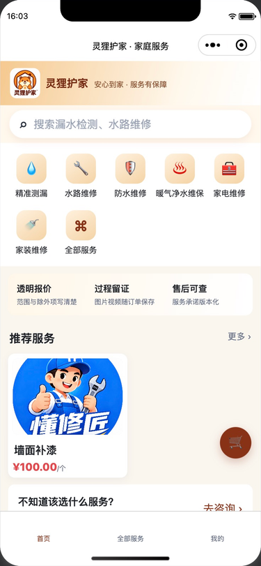
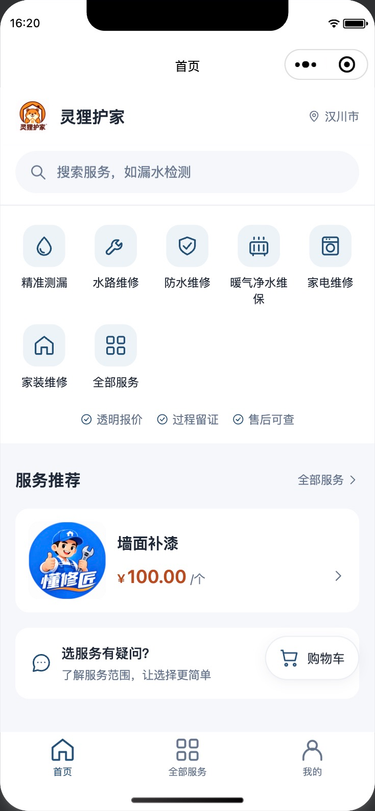
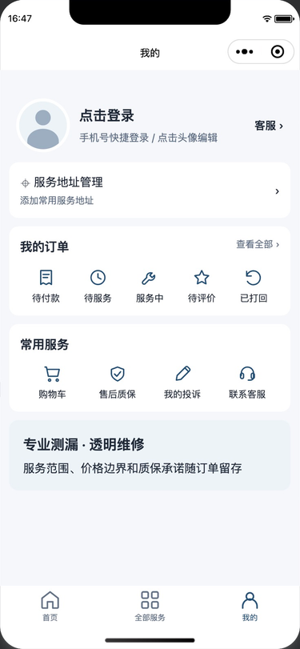

# PLAN-014｜深蓝视觉与首页优化实施记录

**日期：** 2026-10-28  
**状态：** 页面实现与本机检查完成；完整模拟器操作及 iOS/Android 真机验收待完成  
**计划：** [PLAN-014](../plans/PLAN-014-客户小程序深蓝视觉与首页优化.md)

## 1. 本轮完成的实现

- 新增 `styles/theme.wxss`，使用白/浅灰表面、深蓝操作色、低饱和价格色和独立危险操作色。
- 首页品牌栏固定 60px，36px 等比例 logo，单行显示品牌和汉川市；原生标题改为“首页”。
- 搜索区位于首页根布局中，保留页面级 sticky，搜索框 44px；支持下拉刷新。
- 分类使用稳定 ID/语义名称映射的本地线性图标，未知分类回退为通用图标；保留最多八类及全部服务入口。
- “暖气净水维保”在首页用“暖气净水”简称，完整分类名仍用于原数据与无障碍名称；避免窄列最后一个字单独换行。
- 保障区压缩为一行；推荐改为单列横向卡，使用真实服务名、描述、价格与单位，支持封面失败占位。
- 服务推荐按目录顺序去重后取前四项，不引入假热门、假销量或示例价格。
- 首页公开目录与私有购物车数量分别加载；游客不取私有购物车；购物车失败不使目录消失。
- 增加响应序号和会话 epoch 检查，避免旧请求、离开页面后的响应或旧身份的数量覆盖当前状态。
- 帮助入口改为实用选择说明；购物车改为白底线性图标与数量角标。
- 统一服务列表、搜索、详情、购物车、结算、结果、地址、登录、资料、订单和客户工作台的主题与必要间距。
- 新增原生 TabBar 普通/选中图标；复用已有购物车图形，替换客户页面中的主要 emoji 图标。
- 删除客户工作台的“SOP / Sprint”占位说明，替换为面向用户的订单进度提示。

本轮未改变服务价格规则、认证接口、订单/购物车接口、城市校验或数据库；已下架服务的不可选逻辑、结构化详情预留内容及已有品牌变更均予以保留。

## 2. 实施基线

开始时工作区已有大量品牌、后台和后端变更。本轮在其上继续实施，没有重置或覆盖原有差异。

本机基线保存于 `.tmp/plan014-baseline/`：

- `git-status.txt`：实施前工作区状态。
- `client-before.patch`：实施前客户小程序已有差异。
- `miniprogram/`：实施前完整客户小程序源文件及资源。
- `home-window.png`：实际微信开发者工具首页截图。

已保留首页的真实改造前截图。改造前的搜索吸顶、详情、购物车和结算没有逐页采集真实截图；这些页面保留了源文件基线，不将改造后的源样式截图当作改造前证据。

## 3. 实际微信开发者工具观察

- 应用版本：2.02.2609232 Nightly。
- 当前模拟器：iPhone 12/13 (Pro)，工具显示缩放 94%。
- 项目配置基础库：3.17.3；页面为原生导航下的 WebView 渲染。
- 实际首页已显示深蓝线性图标、汉川市、搜索、单列服务卡和新的 TabBar。
- 实际个人页显示浅灰背景、统一线性图标和深蓝选中导航。
- 当前公开服务来自本地 API；截图所示墙面补漆及价格为现有目录内容，不是本轮生成的商品。
- 模拟器页面热更新后呈现成功，截图时工具问题栏显示 0；WXML/WXSS 另由官方随工具附带编译器逐文件核对。

### 实际页面截图

以下为微信开发者工具截图裁切出的模拟器区域，保留原生导航与底栏。首页截图采集于本轮实现过程，最终辅助色、分类简称等细节又作了微调。

| 首页改造前 | 深蓝首页 |
| --- | --- |
|  |  |

## 4. 已执行的检查

| 检查 | 执行方式 | 结果 |
| --- | --- | --- |
| TypeScript | `npm run mini:typecheck` | 通过 |
| 首页行为 | `npm run mini:test:home` | 6 项通过 |
| 购物与结算回归 | `npm run mini:test:shopping` | Fixture/Mock 交互断言通过，无真实订单提交 |
| WXML 编译 | 微信开发者工具附带 `wcc` | 15 个页面模板通过 |
| WXSS 编译 | 微信开发者工具附带 `wcsc` | 17 个样式文件通过，含共享主题 |
| 资源引用 | 检查本地 `/assets/` 路径、TabBar 图标和 JSON 配置 | 通过 |
| 源样式布局 | 将当前 WXML/WXSS 及测试数据在独立 Chromium 中渲染 | 15 页面 × 320/375/430px，共 45 个组合无页面横向溢出 |
| 首页布局 | 上述三种宽度测量品牌栏与滚动位置 | 品牌栏均 60px；滚动后搜索顶部位置 0px |
| 文本对比 | 按 sRGB 相对亮度计算当前关键前景/背景组合 | 见下表 |
| 修改格式 | `git diff --check` | 通过 |

### 行为验证覆盖

`test-mini-home.cjs` 覆盖：

1. 目录成功、购物车失败时仍显示服务。
2. 目录失败与空目录区分、重试后恢复。
3. 游客不请求购物车、会话切换后旧数量不回写。
4. 快速刷新与离开页面后的旧响应不会覆盖当前页面。
5. 分类改序、未知类别、八类上限、零价、大金额、绝对图片地址和失败占位。
6. 推荐去重及真实分类/服务 ID 跳转。

`test-mini-shopping.cjs` 使用本地 Fixture/Mock 验证：加购不跳转与角标、立即下单只传当前服务数量、勾选合计、左/右滑动及纵向手势区分、滑动取消、删除确认/取消/失败/成功、数量下限、独立结算载荷。没有执行真实微信授权、位置授权或真实 API 下单。

### 可读性微调

原建议辅助色 `#64748B` 在浅灰背景上的对比度约 4.43:1，在浅蓝背景上约 4.25:1。因此实际辅助色改为稍深的 `#5F6F84`，视觉方向保持一致，同时满足普通正文目标。Plan 与视觉方案已同步。

| 前景 / 背景 | 对比度 |
| --- | --- |
| 辅助文字 `#5F6F84` / 白色 | 5.13:1 |
| 辅助文字 `#5F6F84` / 页面浅灰 | 4.78:1 |
| 辅助文字 `#5F6F84` / 浅蓝底板 | 4.59:1 |
| 白色 / 深蓝主按钮 | 8.60:1 |
| 价格 `#B94B20` / 白色 | 5.13:1 |
| 危险操作 `#C83E3E` / 白色 | 4.98:1 |

## 5. 源样式补充截图

以下使用当前源码和专用测试数据生成，用于尺寸、长名称、角标和面板的布局检查。它们不是微信运行截图，也不是实际商品或账户数据。

- [320px 首页长名称/大金额](assets/plan014/home-index-320-layout.png)
- [375px 首页](assets/plan014/home-index-375-layout.png)
- [430px 首页](assets/plan014/home-index-430-layout.png)
- [服务列表](assets/plan014/services-index-375-layout.png)
- [搜索结果](assets/plan014/search-index-375-layout.png)
- [服务详情与底部操作](assets/plan014/services-detail-375-layout.png)
- [购物车左滑及下架状态](assets/plan014/cart-index-375-layout.png)
- [结算页](assets/plan014/checkout-index-375-layout.png)
- [预约面板](assets/plan014/checkout-picker-375-layout.png)
- [汉川市地址表单](assets/plan014/addresses-edit-375-layout.png)
- [地址列表](assets/plan014/addresses-index-375-layout.png)
- [订单列表](assets/plan014/orders-index-375-layout.png)
- [订单详情](assets/plan014/orders-detail-375-layout.png)
- [登录](assets/plan014/login-index-375-layout.png)
- [资料编辑](assets/plan014/profile-edit-375-layout.png)
- [客户工作台](assets/plan014/workbench-index-375-layout.png)

源样式布局工具与编译输出留在 `.tmp/plan014-validation/` 及 `.tmp/plan014-layout*`，用于本轮复核；可重复的业务行为脚本保存在 `scripts/`。源样式检查不替代微信原生布局、触控、安全区和字号行为验收。

## 6. 验收矩阵状态

| 编号 | 当前证据 | 状态 |
| --- | --- | --- |
| AC-01 首页整体 | 实际首页/个人页截图、主题和图标检查 | 本机通过 |
| AC-02 顶部尺寸 | 三种宽度源样式测量 60px | 布局检查通过，系统大字体/真机待验 |
| AC-03 搜索吸顶 | 三种宽度 Chromium 滚动位置检查；页面级 sticky | 源样式通过，模拟器触控/真机待验 |
| AC-04 分类 | Fixture 改序、未知类别、八类保留与 ID 跳转 | 行为检查通过，真实点击待验 |
| AC-05 服务卡 | 真实目录首页、测试长名称/空描述/图片失败/大金额/单位 | 本机通过，真机待验 |
| AC-06 数据失败隔离 | 首页自动化测试 | 通过 |
| AC-07 身份变化 | 游客与 epoch/旧响应测试 | 本机通过，真实微信会话待验 |
| AC-08 加购与立即下单 | 原交易代码保留、交互及结算载荷 Mock 检查 | 本机通过，真实链路待验 |
| AC-09 购物车 | 手势、数量、删除 Mock 与源样式左滑截图 | 本机通过，真实触控待验 |
| AC-10 勾选结算 | 选择合计 Mock；原补充信息与结算逻辑保留 | 部分本机通过，完整资料保存链路待验 |
| AC-11 地址与预约 | 原城市/定位逻辑保留、表单和面板源样式截图 | 布局通过，真实授权/操作待验 |
| AC-12 小屏/安全区 | 45 组合无页面横向溢出，安全区 padding 保留 | 本机通过，键盘/刘海/底部触控待验 |
| AC-13 共享样式 | 15 页源样式检查及实际个人页 | 本机通过，真实页面操作待验 |
| AC-14 文案与触达 | 开发术语扫描、帮助提示及对比度检查 | 文案/对比度通过，触控待验 |

## 7. 待完成项及限制

1. 未连接 iOS 和 Android 实机；真实微信登录/位置授权、手势、键盘、安全区和系统大字体验收仍需完成。
2. 本机 IDE 的 CLI 服务端口处于关闭状态；保留了该设置。界面读取和截图可用，但原生窗口输入接口未能稳定完成点击/滚动自动化。因此没有把源样式滚动检查记成真实模拟器操作通过。
3. 当前目录中的墙面补漆封面仍是既有“懂修匠”示意素材。前端继续显示真实接口内容，没有擅自修改运营素材；正式服务照片与最新品牌内容需由运营整理替换。
4. 旧版详情的服务文本/价格单位还可能需要 SPEC-013 的独立内容工作。本轮只调整视觉，未生成墙面补漆样板或更改购买承诺。
5. 尚未发布、上传或创建 Git 提交。回退只针对本轮基线后的主题与页面差异，避免覆盖同期未提交工作。
